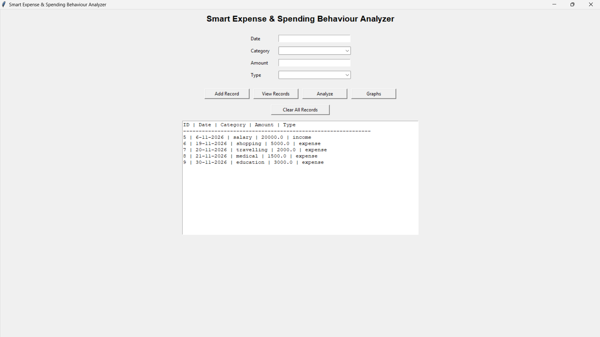
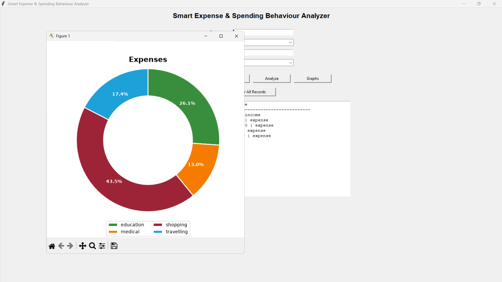
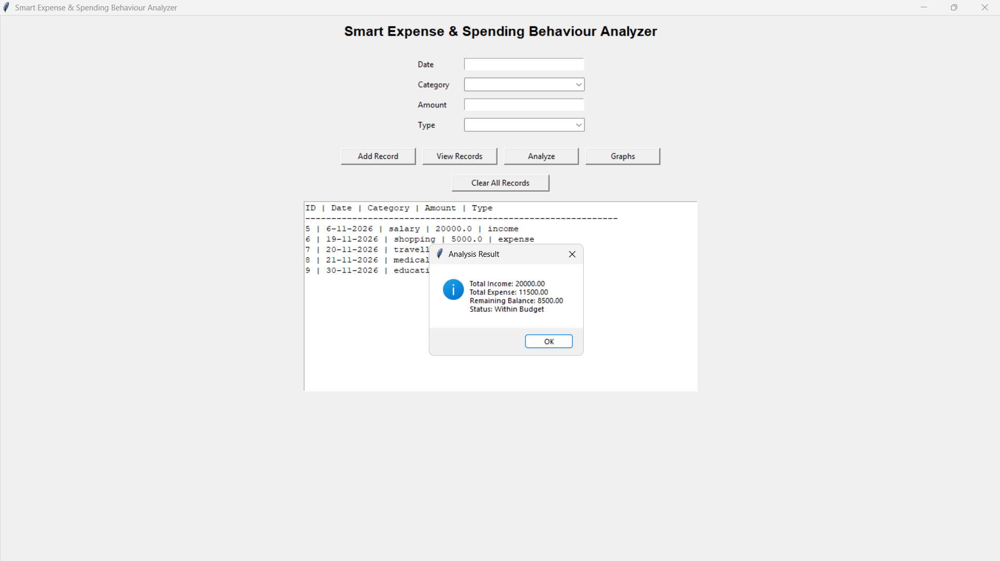

# Smart Expense & Spending Behaviour Analyzer

A desktop-based personal finance management application built using Python, C, SQLite and Matplotlib. It allows users to record income and expenses, monitor their financial balance, analyze spending and visualize financial data through graphical representations.

## Overview

Managing personal finances requires keeping track of income, expenses and remaining balances. This project provides a simple desktop application that helps users maintain financial records and understand their spending patterns.

The application combines Python for graphical user interaction and database management with C for financial calculations and spending analysis.

## Features

- **Income and Expense Management:** Add financial records with dates, categories, amounts and transaction types.
- **Record Management:** View stored financial transactions.
- **Financial Analysis:** Calculate total income, total expenses and remaining balance.
- **Overspending Detection:** Identify when total expenses exceed total income.
- **Data Visualization:** Generate donut charts to visualize income and expenses by category.
- **Database Storage:** Store financial records persistently using SQLite.
- **C and Python Integration:** Execute C-based financial analysis through Python.
- **Automatic Compilation:** Compile the C source code using GCC when the executable is missing or the source has been updated.

## Technologies Used

| Technology | Purpose |
|---|---|
| Python | Main application logic |
| Tkinter | Graphical user interface |
| SQLite | Financial data storage |
| C | Financial calculations and analysis |
| Matplotlib | Data visualization |
| GCC | C program compilation |

## Project Architecture

The application follows a Python-C integration approach.

1. Users enter income and expense records through the Tkinter interface.
2. Python stores the records in an SQLite database.
3. Python retrieves transaction types and amounts and exports them to `data.txt`.
4. The C program reads the exported data and calculates total income, total expenses and remaining balance.
5. The C program detects whether overspending has occurred and writes the results to `result.txt`.
6. Python reads and displays the analysis results.

## Project Structure

```text
Smart-Expense-Analyzer/
│
├── main.py
├── analyze.c
├── requirements.txt
├── README.md
├── LICENSE
├── .gitignore
│
└── screenshots/
```

The SQLite database and analysis text files are generated locally when the application runs and are not included in the repository.

## Prerequisites

Before running the application, ensure that you have:

- Python 3 installed.
- GCC compiler installed and configured in your system PATH.
- Git is optional for running the application.

## Installation and Setup

### 1. Clone the repository

```bash
git clone https://github.com/YOUR-USERNAME/Smart-Expense-Analyzer.git
```

### 2. Navigate to the project directory

```bash
cd Smart-Expense-Analyzer
```

### 3. Install dependencies

```bash
python -m pip install -r requirements.txt
```

### 4. Verify GCC installation

```bash
gcc --version
```

### 5. Run the application

```bash
python main.py
```

The application automatically creates the SQLite database when it is first launched. The C analysis program is compiled automatically when required.

## How to Use

1. Launch the application.
2. Enter the transaction date.
3. Select a financial category.
4. Enter the transaction amount.
5. Choose whether the transaction is income or expense.
6. Click **Add Record** to save the transaction.
7. Use **View Records** to display saved transactions.
8. Click **Analyze** to calculate your financial summary and detect overspending.
9. Click **Graphs** to visualize income and expenses by category.

## Future Enhancements

- Monthly and yearly financial reports.
- Budget allocation and category-wise spending limits.
- Advanced spending behaviour analysis.
- Improved financial dashboards.
- Export reports in CSV and PDF formats.
- Enhanced data security and user authentication.

## License

This project is distributed under the MIT License. See the `LICENSE` file for details.


## Application Screenshots

### Main Interface


### Expense Visualization


### Financial Analysis

